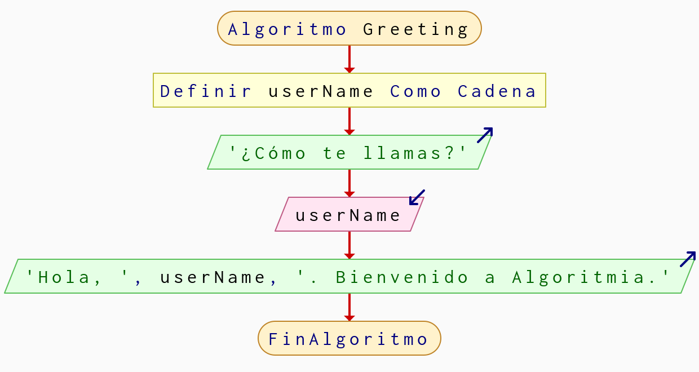
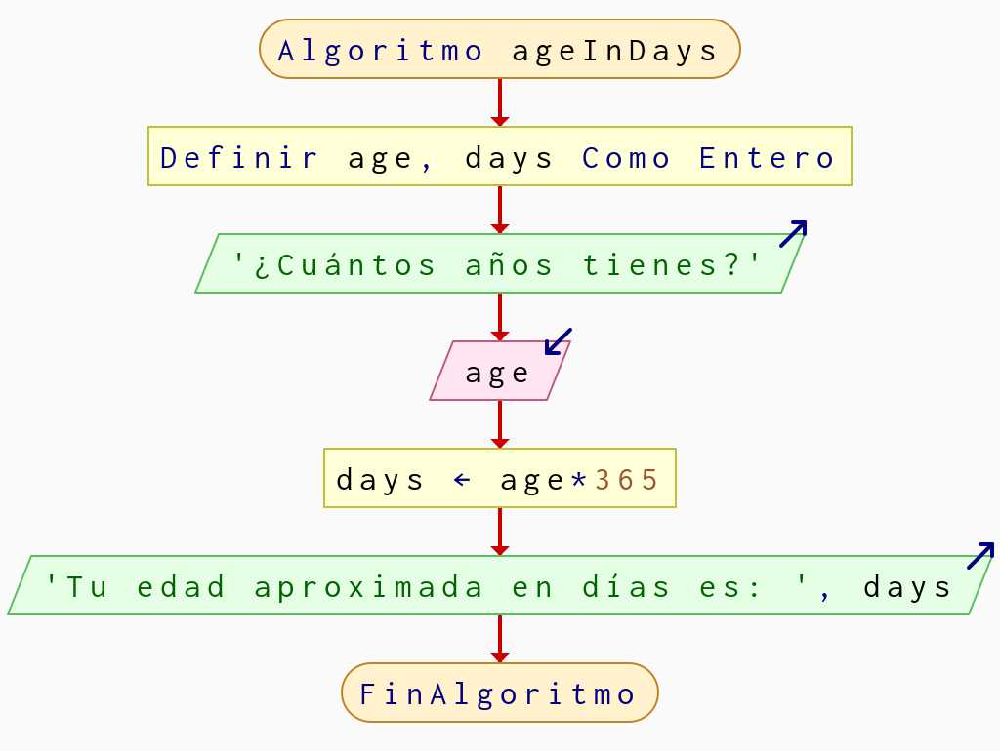
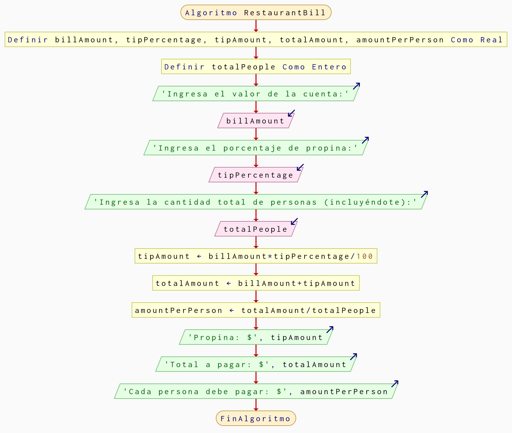
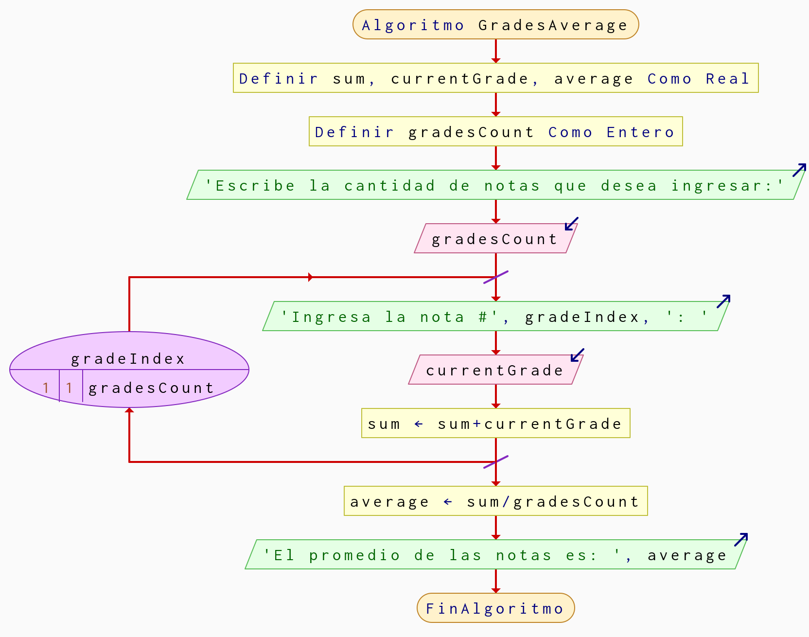

# Algoritmia - Sesión 1
Conjunto de algoritmos simples hechos en PSeint y en lenguaje natural.

## Retos del video
Retos del video de moodle sesión 1 con pruebas.

### 1. [Saludo](Saludo.psc)
Solo muestra el nombre del usuario con un mensaje de bienvenida.

#### Prueba 1
- **Entrada**: Felipe
- **Salida**: Hola, Felipe. Bienvenido a Algoritmia
#### Prueba 2
- **Entrada**: John
- **Salida**: Hola, John. Bienvenido a Algoritmia

### 2. [Edad en días](EdadEnDias.psc)
Algoritmo que muestra la edad aproximada en días.

#### Prueba 1
- **Entrada**: 22
- **Salida**:  Tu edad aproximada en días es: 8030
#### Prueba 2
- **Entrada**: 1
- **Salida**:  Tu edad aproximada en días es: 365

### 3. [Propinas](Propinas.psc)
Calcula cuanto debe pagar cada persona una cuenta de forma equitativa.

#### Prueba 1
- **Entrada**: 
1. 150000 (cuenta)
2. 15 (\% de propina)
3. 4 (cantidad de personas)

- **Salida**:
1. Propina: $22500
2. Total a pagar: $172500
3. Cada persona debe pagar: $43125
#### Prueba 2
- **Entrada**: 
1. 89000 (cuenta)
2. 5 (\% de propina)
3. 3 (cantidad de personas)

- **Salida**:
1. Propina: $4450
2. Total a pagar: $93450
3. Cada persona debe pagar: $31150

### 4. [Promedio Notas](PromedioNotas.psc)
Calcula el promedio de las notas que el usuario ingrese. 

#### Prueba 1
- **Entrada**: 
1. 3 (cantidad de notas)
2. 3.5 (nota 1)
3. 3 (nota 2)
4. 5 (nota 3)

- **Salida**:
1. El promedio de las notas es: 3.833333333
#### Prueba 2
- **Entrada**: 
1. 5 (cantidad de notas)
2. 4.2 (nota 1)
3. 4.1 (nota 2)
4. 3.3 (nota 3)
5. 4.9 (nota 4)
6. 5 (nota 5)

- **Salida**:
1. El promedio de las notas es: 4.3

### 5. [Tinto](tinto.md)
Algoritmo de cómo preparar un tinto. Presiona el vínculo (título) para abrirlo.
