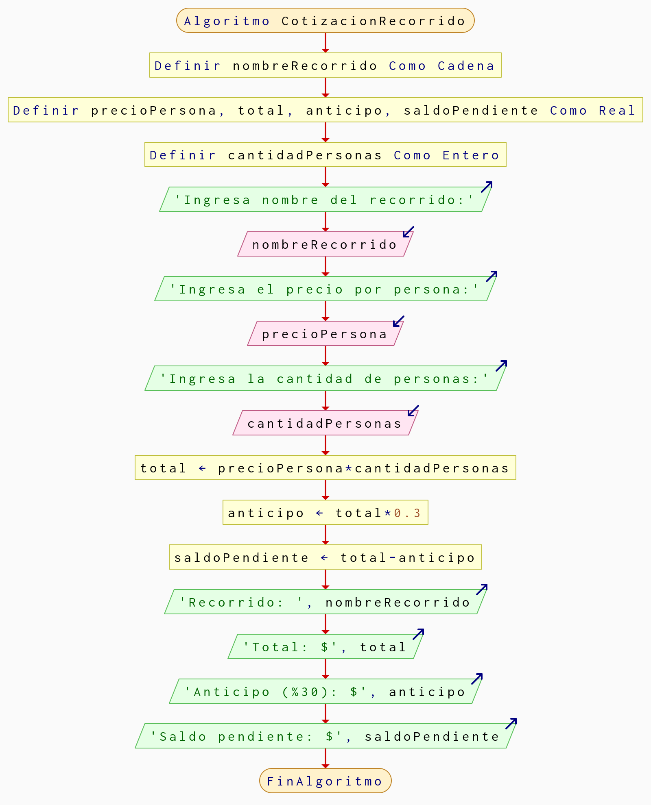

# Bitácora
## Día 1 - Kilómetro 0: el alquiler sin ambigüedades
### Algoritmo de ¿Cómo alquilar una bicicleta?

1. Entra al local de Rueda Libre.
2. Saluda a un asesor.
3. Dile que: "Quiero alquilar una bicicleta"
4. Si responde de forma afirmativa, siguelo para hacer la reserva.
5. Si te dice que todas las bicicletas están alquiladas o alguna otra novedad, despidete y sal del local.
6. Elija la bicicleta que quieres.
7. Si el asesor dice la bicicleta que no está disponible, selecciona otra.
8. Si la bicleta está disponible, continúa con el proceso de reserva.
9. Dile que quieres reservar la bicicleta para ahora.
10. Si responde que no hay agenda, pregunta por la fecha más próxima.
11. Si hay disponibilidad para esa fecha, elije la hora para recoger la bici, da las gracias y sal del local.
12. Si hay para el momento, continúa con la reserva.
13. Haz el pago en caja.
13. Muestra tu documento de identidad para que el asesor valide los datos.
14. Firma el contrato de alquiler.
15. Recibe la bicicleta, el casco y candado.
16. Revisa que los frenos y las llantas funciones.
17. Ponte el casco.
18. Sal del local con la bicicleta, el casco y el candado.
19. Fin.

### Ambigüedades encontradas
1. **Paso 2:** “un asesor” no indica dónde está ni cómo identificarlo.
2. **Paso 4:** “Si responde de forma afirmativa” no dice a qué pregunta se responde “sí”, porque en el paso 3 no hiciste ninguna pregunta, solo una afirmación.
3. **Paso 4:** “siguelo para hacer la reserva” no dice qué hacer. No queda claro si debes caminar hacia algún lugar, pedir el catálogo o esperar instrucciones.
4. **Paso 5:** “alguna otra novedad” no dice qué puede ser, así que no se sabe cuándo aplicar este paso.
5. **Paso 5:** el paso mezcla casos distintos (no hay bicicletas, hay otra novedad) y no indica un final claro, solo “sal del local”.
6. **Paso 6:** no dice cómo se elige la bicicleta (por tipo de recorrido, por talla, por precio) ni dónde se ven las opciones.
7. **Paso 7:** “Si el asesor dice la bicicleta que no está disponible” no indica cuándo ni cómo el asesor lo informa, porque nunca se le pregunta si está disponible. Además, no dice qué hacer si ya no quedan otras bicicletas para elegir.
8. **Paso 8:** “continúa con el proceso de reserva” es vago, porque no dice cuál es el siguiente paso concreto.
9. **Paso 9:** “reservar la bicicleta para ahora” es contradictorio, porque una reserva es para después y un alquiler inmediato no necesita reserva.
10. **Paso 10:** “no hay agenda” no está definido. No se sabe si significa que no hay bicicletas ahora o que no hay citas.
11. **Paso 10:** “la fecha más próxima” no indica cómo se obtiene la fecha ni qué hacer si el asesor no tiene ninguna disponible.
12. **Paso 11:** si no hay disponibilidad en esa fecha, no hay instrucción. Falta el caso “no”.
13. **Paso 11:** “da las gracias y sal del local” no dice si se recibe algún comprobante de la reserva, ni si el algoritmo termina ahí.
14. **Paso 12:** “Si hay para el momento” es impreciso, porque no dice qué es “el momento” ni a qué se refiere “hay”.
15. **Paso 13 (pago):** “Haz el pago en caja” no dice cuánto se paga, con qué medio ni qué hacer si el pago falla.
16. **Paso 13 (documento):** el orden es ambiguo, porque el pago va antes de validar el documento. Además, no dice qué hacer si el asesor no puede validar los datos.
17. **Numeración:** hay dos pasos numerados 13.
18. **Paso 15:** “Recibe la bicicleta, el casco y candado” no dice quién entrega el equipo ni si hay que confirmar que está completo.
19. **Paso 16:** “Revisa que los frenos y las llantas funciones” no indica cómo revisarlos ni qué hacer si algo falla.
20. **Paso 17:** “Ponte el casco” no dice si debe quedar ajustado ni qué hacer si no queda firme.
21. **Paso 18:** no se verifica que el candado tenga su llave o clave antes de salir.

### Algorimo de ¿Cómo alquilar una bicicleta? (Corregido)

1. Inicio.
2. Entra al local de Rueda Libre.
3. Saluda al asesor en el mostrador.
4. Dile: “Quiero alquilar una bicicleta”.
5. Pregunta al asesor: ¿hay bicicletas disponibles hoy?
6. **Si responde “no”** (todas están alquiladas), agradece, despídete, sal del local y ve al **Fin**.
7. **Si responde “sí”**, pide el catálogo al asesor.
8. Elige una bicicleta según el tipo de recorrido que quieras hacer.
9. Dile al asesor por cuántas horas quieres alquilarla.
10. Pregunta al asesor si esa bicicleta está disponible ahora durante ese número de horas.
11. **Si no está disponible y quedan otras en el catálogo**, ve al paso 7.
12. **Si no está disponible y no quedan otras**, pregunta por la fecha y hora más próximas con disponibilidad para ese número de horas.
13. **Si hay disponibilidad en esa fecha**, elige la hora de recogida, pide el comprobante de la reserva (con fecha, hora de inicio y horas reservadas), da las gracias, sal del local y ve al **Fin**.
14. **Si no hay disponibilidad**, agradece, despídete, sal del local y ve al **Fin**.
15. **Si la bicicleta está disponible ahora**, muestra tu documento de identidad para que el asesor registre tus datos.
16. Pregunta el valor de la tarifa por hora, confirma el total (tarifa por hora × número de horas) y paga en caja. Si el pago es rechazado, intenta con otro medio de pago. Si tampoco es posible, ve al paso 13.
17. Guarda el comprobante de pago y confirma con el asesor la hora exacta en que debes devolver la bicicleta.
18. Firma el contrato de alquiler.
19. Recibe la bicicleta, el casco y el candado.
20. Revisa que los frenos y las llantas funcionen.
21. **Si algo falla**, pide otra bicicleta al asesor y repite desde el paso 19.
22. Ponte el casco y ajusta la correa hasta que quede firme.
23. **Si no queda firme**, pide otra talla de casco y repite desde el paso 21.
24. Verifica que tienes el candado y su llave (o clave).
25. Sal del local con la bicicleta, el casco y el candado.
26. Fin.

## Día 2 - La primera cotización en PSeInt

### Tabla
| Entrada               | Proceso                    | Salida                                    |
| --------------------- | -------------------------- | ----------------------------------------- |
| nombreCliente (Texto) | -                          | Imprime: nombreCliente  (e.g  Emanuel) |
| horas (Entero)        | total = horas \* valorHora | Imprime: total (e.g 40000)             |

Se ha creado el algoritmo: [CotizacionBasica](./algoritmos/01_cotizacion_basica.psc)
### Observaciones del algoritmo 

#### Casos de prueba
| Nombre | Hora    | Resultado esperado                                   | Resultado obtenido                                   |
| ------ | ------- | ---------------------------------------------------- | ---------------------------------------------------- |
| Felipe | 1 hora  | "Hola, Felipe: tu alquiler de 1 horas cuesta $10000" | "Hola, Felipe: tu alquiler de 1 horas cuesta $10000" |
| Felipe | 3 horas | "Hola, Felipe: tu alquiler de 3 horas cuesta $30000" | "Hola, Felipe: tu alquiler de 3 horas cuesta $30000" |
| Felipe | 8 horas | "Hola, Felipe: tu alquiler de 8 horas cuesta $80000" | "Hola, Felipe: tu alquiler de 8 horas cuesta $80000" |

#### ¿Qué pasa si alguien ingresa 0 o números negativos?
El algoritmo hara las operaciones sin problema, pero mostraría cosas que no se desean, como que: "tu alquiler de 0 horas cuesta \$0" o "tu alquiler de \-4 horas cuesta \$-40000". 

Esto se corregirá en la semana 2.

### Día 3 - Recorridos guiados\: del pseudocódigo al diagrama de flujo

Se hizo el algoritmo [CotizacionRecorrido](./algoritmos/02_cotizacion_recorrido.psc).

#### Prueba de escritorio

- `nombreRecorrido` = “Sabores de Barrio”
- `precioPersona` = 60000
- `cantidadPersonas` = 4

| Paso | Instrucción                                   | `nombreRecorrido`   | `precioPersona` | `cantidadPersonas` | `total`     | `anticipo`  | `saldoPendiente` | Resultado                               |
| ---- | --------------------------------------------- | ------------------- | --------------- | ------------------ | ----------- | ----------- | ---------------- | --------------------------------------- |
| 1    | Definir variables                             | (sin valor)         | (sin valor)     | (sin valor)        | (sin valor) | (sin valor) | (sin valor)      | Se reservan las variables               |
| 2    | Escribir “Ingresa nombre del recorrido:”      | (sin valor)         | (sin valor)     | (sin valor)        | (sin valor) | (sin valor) | (sin valor)      | Muestra la solicitud                    |
| 3    | Leer nombreRecorrido                          | “Sabores de Barrio” | (sin valor)     | (sin valor)        | (sin valor) | (sin valor) | (sin valor)      | Se almacena el nombre                   |
| 4    | Escribir “Ingresa el precio por persona:”     | “Sabores de Barrio” | (sin valor)     | (sin valor)        | (sin valor) | (sin valor) | (sin valor)      | Muestra la solicitud                    |
| 5    | Leer precioPersona                            | “Sabores de Barrio” | 60000           | (sin valor)        | (sin valor) | (sin valor) | (sin valor)      | Se almacena 60000                       |
| 6    | Escribir “Ingresa la cantidad de personas:”   | “Sabores de Barrio” | 60000           | (sin valor)        | (sin valor) | (sin valor) | (sin valor)      | Muestra la solicitud                    |
| 7    | Leer cantidadPersonas                         | “Sabores de Barrio” | 60000           | 4                  | (sin valor) | (sin valor) | (sin valor)      | Se almacena 4                           |
| 8    | total = 60000 * 4                             | “Sabores de Barrio” | 60000           | 4                  | 240000      | (sin valor) | (sin valor)      | total = 240000                          |
| 9    | anticipo = 240000 * 0.3                       | “Sabores de Barrio” | 60000           | 4                  | 240000      | 72000       | (sin valor)      | anticipo = 72000                        |
| 10   | saldoPendiente = 240000 - 72000               | “Sabores de Barrio” | 60000           | 4                  | 240000      | 72000       | 168000           | saldoPendiente = 168000                 |
| 11   | Escribir “Recorrido: “, nombreRecorrido       | “Sabores de Barrio” | 60000           | 4                  | 240000      | 72000       | 168000           | Muestra: _Recorrido: Sabores de Barrio_ |
| 12   | Escribir “Total: $”, total                    | “Sabores de Barrio” | 60000           | 4                  | 240000      | 72000       | 168000           | Muestra: _Total: $240000_               |
| 13   | Escribir “Anticipo (%30): $”, anticipo        | “Sabores de Barrio” | 60000           | 4                  | 240000      | 72000       | 168000           | Muestra: _Anticipo (%30): $72000_       |
| 14   | Escribir “Saldo pendiente: $”, saldoPendiente | “Sabores de Barrio” | 60000           | 4                  | 240000      | 72000       | 168000           | Muestra: _Saldo pendiente: $168000_     |

#### Diagrama

**Simbolos:**
1. **Oválo (Rectangulo con esquinas redondeadas)**: Inicio/Fin del algoritmo.
2. **Rectángulo**: Proceso
3. **Paralelogramo**: entrada y salida

### Día 4 - Asistente de taquilla v0.1: la cuenta del grupo
#### Descomposición del problema
**¿Qué ingresa el usuario?**
| Dato                             | Variable             | Origen               |
| -------------------------------- | -------------------- | -------------------- |
| Precio por hora de una bicicleta | `precioHora`         | Constante (10000)    |
| Cantidad de personas             | `cantidadPersonas`   | Lo digita el usuario |
| Cantidad de bicicletas           | `cantidadBicicletas` | Lo digita el usuario |
| Horas de alquiler                | `horas`              | Lo digita el usuario |
| Precio del recorrido por persona | `precioPersona`      | Lo digita el usuario |

**Lista de cálculos**
| Orden | Cálculo                                                                         | Fórmula                                                      | Datos que usa                               |
| ----- | ------------------------------------------------------------------------------- | ------------------------------------------------------------ | ------------------------------------------- |
| 1     | Valor unitario de la bicicleta por el tiempo (se muestra en la columna “Valor”) | `precioHora * horas`                                         | `precioHora`, `horas`                       |
| 2     | Valor del alquiler                                                              | `cantidadBicicletas * horas * precioHora`                    | `cantidadBicicletas`, `horas`, `precioHora` |
| 3     | Valor del recorrido                                                             | `precioPersona * cantidadPersonas`                           | `precioPersona`, `cantidadPersonas`         |
| 4     | Subtotal                                                                        | `valorAlquiler + valorRecorrido`                             | resultados de los pasos 2 y 3               |
| 5     | Aporte voluntario (10%)                                                         | `subtotal * 0.10`                                            | resultado del paso 4                        |
| 6     | Total                                                                           | `subtotal + aporteVoluntario`                                | resultados de los pasos 4 y 5               |
| 7     | Valor por persona (redondeado hacia arriba a múltiplos de 100)                  | `trunc((total / cantidadPersonas + 99.9999999) / 100) * 100` | resultado del paso 6 y `cantidadPersonas`   |

Primero se debe calcular en ese orden el valor del alquiler y el valor del recorrido, porque son las que van a usarse más adeltante en el subtotal, que se usará para calcular el aporte, que permitirá calcular el aporte del 10% para finalmente generar el total y el valor por persona.

Se hizo el algoritmo [CuentaGrupo](./algoritmos/03_cuenta_grupo.psc).

#### ¿Cómo funciona el redondeo de 100 hacia arriba?
`trunc`, e incluso `redon`, solo pueden redondear números decimales. `trunc` los redondea siempre hacia abajo (solo en números positivos), mientras que `redon` lo hace al valor entero más cercano: si la parte decimal es menor a .5, hacia abajo; si es mayor o igual a .5, hacia arriba. Partiendo de esa idea, el precio debía dividirse entre algo para que quedara en decimal, y como debía quedar en centenas, lo hice entre 100; lo siguiente era redondear el resultado y multiplicarlo por 100 otra vez para devolverlo a su escala original.

Como `trunc` siempre redondea hacia abajo, usé `trunc` junto con la suma de `99.9999999` antes de dividir entre 100. Ese valor, casi 100, hace que cualquier resto por encima de un múltiplo de 100 cruce al siguiente múltiplo, mientras que un valor que ya es múltiplo exacto de 100 no sube. Así se logra redondear hacia arriba de forma más consistente que con `redon`, que solo habría subido cuando el resto fuera de 50 o más.

