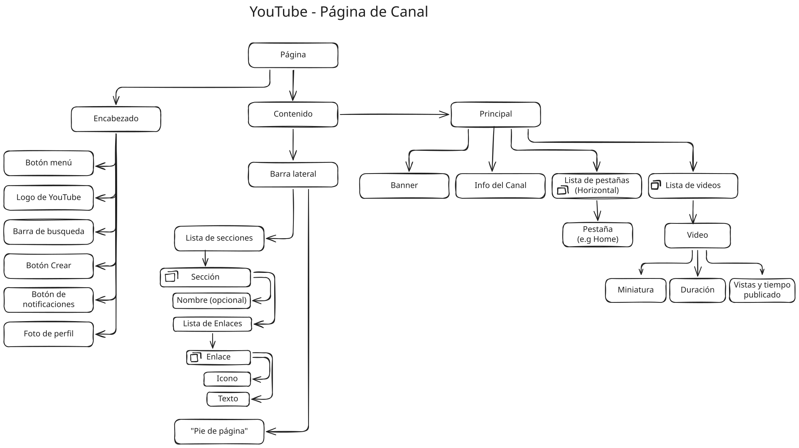
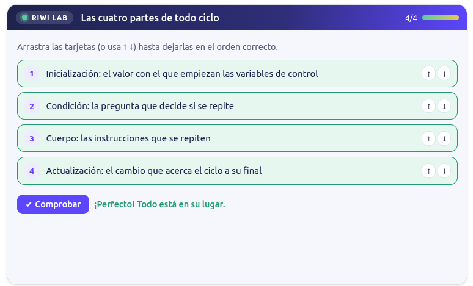
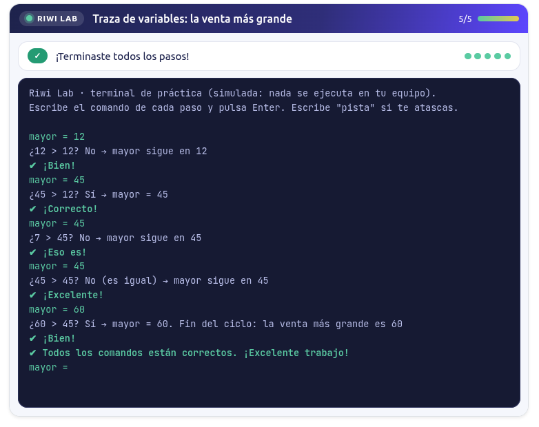
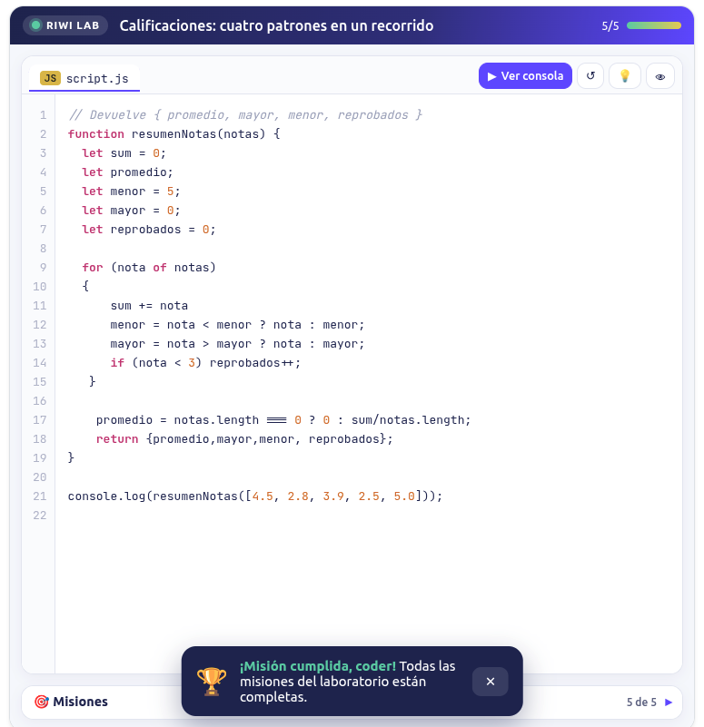
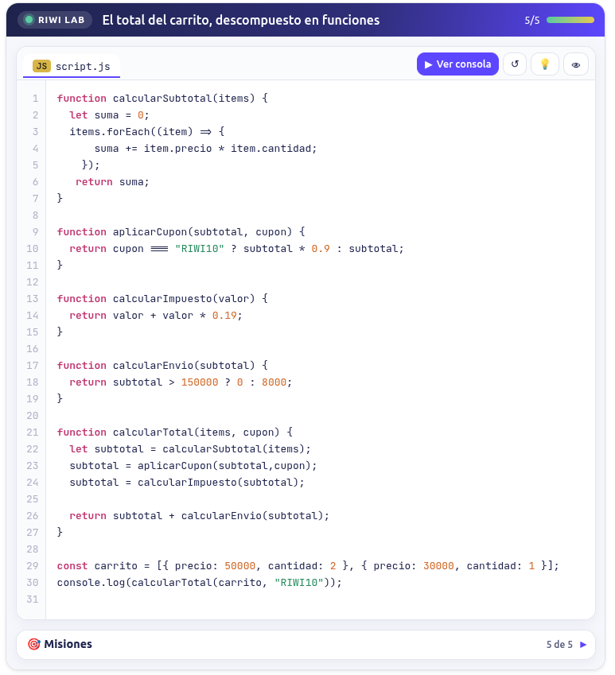
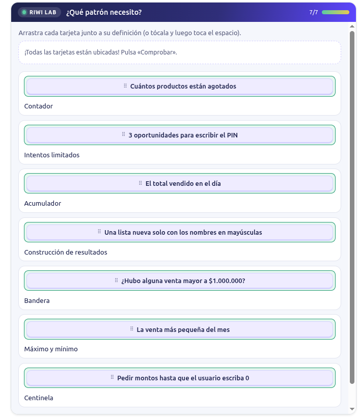

# Algoritmia - Sesión 3
Ejercicios de PSeInt de ciclos.

## Retos del video
Algoritmos de PSeInt de ciclos con su traza.

### 1. [ValidarPIN](ValidarPIN.psc)
Valida si un pin es correcto con 3 intentos.
> [!NOTE]
> **Explicación**
>
> Con un ciclo **Repetir**, al usuario se le pide su PIN y su valor se guarda en la variable entera **pin**, mientras la variable entera **intentos** cuenta cada intento. Si **pin = 2580**, la variable lógica **acceso** pasa a **Verdadero**. El ciclo termina cuando hay **acceso** o **intentos = 3**.
>
> Si hay **acceso**, mostrará el mensaje: *Bienvenido.* De lo contrario mostrará: *Tarjeta bloqueada.*
#### Traza

| Iteración       | Pin  | Intentos | Acceso    |
| --------------- | ---- | -------- | --------- |
| Antes del ciclo | 0    | 0        | Falso     |
| 1               | 1234 | 1        | Falso     |
| 2               | 0000 | 2        | Falso     |
| 3               | 2580 | 3        | Verdadero |
### 2. [CajeroParqueadero](CajeroParqueadero.psc)
Algoritmo que acumula el pago que recibe por cada carro en un parqueadero y muestra el total hasta que se coloca 0.
> [!NOTE]
> **Explicación**
>
> Al usuario se le pide el valor cobrado y su valor se guarda en la variable real **tarifa**. Mientras **tarifa <> 0**, se suma a la variable real **total** y la variable entera **carros** aumenta en 1, y se vuelve a pedir otro valor.
>
> Al ingresar 0, se cierra la caja y se muestran los mensajes con el total de carros y dinero recaudado: *Carros atendidos: (carros)* y *Total recaudado: $(total)*.
#### Traza

| Vuelta                | Valor Carro | Total | Carros | Lee  |
| --------------------- | ----------- | ----- | ------ | ---- |
| Antes del ciclo       | 4000        | 0     | 0      | -    |
| 1                     | 4000        | 4000  | 1      | 8000 |
| 2                     | 8000        | 12000 | 2      | 2000 |
| 3                     | 2000        | 14000 | 3      | 0    |
| Termina (centinela 0) | 0           | 14000 | 3      | -    |
### 3. [Calificaciones](Calificaciones.psc)
Recibe la nota de 5 estudiantes y calcula el promedio, cantidad de aprobados, nota mayor y menor, y si alguien perdió.
> [!NOTE]
> **Explicación**
>
> Con un ciclo **Para** se le piden 5 notas al usuario, cada una guardada en la variable real **nota**. Si **nota >= 3.0**, aumenta en 1 la variable entera **aprobados**; de lo contrario, la variable lógica **alguienPerdio** pasa a **Verdadero**. También se actualizan **notaMayor** (inicia en 0) y **notaMenor** (inicia en 5), y cada nota se suma en **suma**.
>
> Al terminar, **promedio** es **suma / 5** y se muestran los mensajes: *Promedio: (promedio)*, *Aprobados: (aprobados)*, *Nota más alta: (notaMayor)* y *Nota más baja: (notaMenor)*. Si **alguienPerdio** es Verdadero, mostrará: *Hay estudiantes que no aprobaron*.
#### Traza

| Iteración       | Lee Nota | Nota  Menor | Nota Mayor | Suma | Aprobados | Alguien Perdió? |
| --------------- | -------- | ----------- | ---------- | ---- | --------- | --------------- |
| Antes del ciclo | -        | 5           | 0          | 0    | 0         | Falso           |
| 1               | 3.5      | 3.5         | 3.5        | 3.5  | 1         | Falso           |
| 2               | 2.8      | 2.8         | 3.5        | 6.3  | 1         | Verdadero       |
| 3               | 4.9      | 2.8         | 4.9        | 11.2 | 2         | Verdadero       |
| 4               | 3.0      | 2.8         | 4.9        | 14.2 | 3         | Verdadero       |
| 5               | 4.2      | 2.8         | 4.9        | 4.2  | 4         | Verdadero       |

### 4. [Piramide](Piramide.psc)
Piramide hecha de asteriscos con ancho de escala configurable.
> [!NOTE]
> **Explicación**
>
> Al usuario se le pregunta la altura de la pirámide y el ancho de los escalones, guardados en las variables enteras **altura** y **anchoEscala**. Si **anchoEscala <= 0**, se cambia a **1**.
>
> Con un ciclo **Para** por cada **fila**, se escriben primero los espacios **(altura - fila) × anchoEscala** y luego los asteriscos **(anchoEscala × 2 × fila) - (2 × anchoEscala - 1)**, para formar una pirámide de escalones.
#### Traza
- **Altura**:  4
- **Ancho Escala**: 1

| Fila | Espacios (altura - fila) \* ancho | Asteriscos (ancho \* 2 \* fila) - (2  \* ancho - 1) | Línea impresa  |
| ---- | --------------------------------- | --------------------------------------------------- | -------------- |
| 1    | 3                                 | 1                                                   | ---*         |
| 2    | 2                                 | 3                                                   | --***         |
| 3    | 1                                 | 5                                                   | -\*\*\*\*\*    |
| 4    | 0                                 | 7                                                   | \*\*\*\*\*\*\* |
- **Altura**:  5
- **Ancho Escala**: 2

| Fila | Espacios (altura - fila) \* ancho | Asteriscos (ancho \* 2 \* fila) - (2  \* ancho - 1) | Línea impresa                      |
| ---- | --------------------------------- | --------------------------------------------------- | ---------------------------------- |
| 1    | 8                                 | 1                                                   | --------*                   |
| 2    | 6                                 | 5                                                   | ------\*\*\*\*\*              |
| 3    | 4                                 | 9                                                   | ----\*\*\*\*\*\*\*\*\*          |
| 4    | 2                                 | 13                                                  | --\*\*\*\*\*\*\*\*\*\*\*\*\*      |
| 5    | 0                                 | 17                                                  | \*\*\*\*\*\*\*\*\*\*\*\*\*\*\*\*\* |

### 5. [FacturaRestaurante](FacturaRestaurante.psc)
Algoritmo de leer un pedido de un restaurante para generar una factura teniendo en cuenta propina y descuento.
> [!NOTE]
> **Explicación**
>
> El algoritmo tiene tres funciones. Primero, **LeerPedido** le pide al usuario el precio de cada platillo (**valor**) y su **cantidad**, sumando **valor × cantidad** en **total**. Se repite hasta que se ingrese 0 en alguno de los dos. El resultado se guarda en la variable real **subtotal**.
>
> Luego, **CalcularPorcentaje** calcula el **impuesto** (**8%**) y la **propina** (**10%**) del subtotal, ambos de tipo Real. Por último, **ImprimirFactura** suma los tres valores en **total** y muestra la factura con las líneas: *Subtotal: $(subtotal)*, *Impuesto: +$(impuesto)*, *Propina: +$(propina)* y *Total: $(total)*.
#### Traza

- **SubProceso/Función**: LeerPedido()

| Iteración       | Indice | Valor | Cantidad | Total |
| --------------- | ------ | ----- | -------- | ----- |
| Antes del ciclo | 1      | -     | -        | -     |
| 1               | 1      | 25000 | 2        | 50000 |
| 2               | 2      | 12000 | 1        | 62000 |
| 3               | 3      | 0     | -        | 62000 |

---
### 6. [Árbol de Cajas](YouTube_box-tree.svg)
Árbol de cajas de la página de canal de YouTube.

## Laboratorios
Prácticas y ejercicios de moodle:

### 1. Las cuatro partes de todo ciclo

### 2. Traza de variables: la venta más grande

### 3. Calificaciones: cuatro patrones en un recorrido

### 4. El total del carrito, descompuesto en funciones

### 5. ¿Qué patrón necesito?

